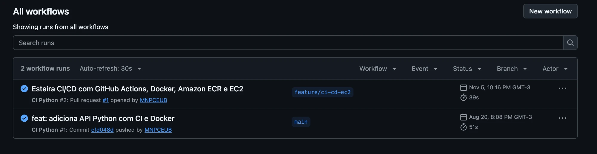
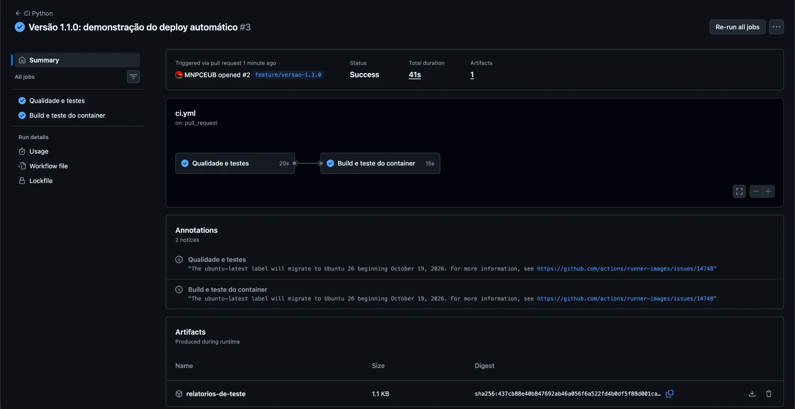
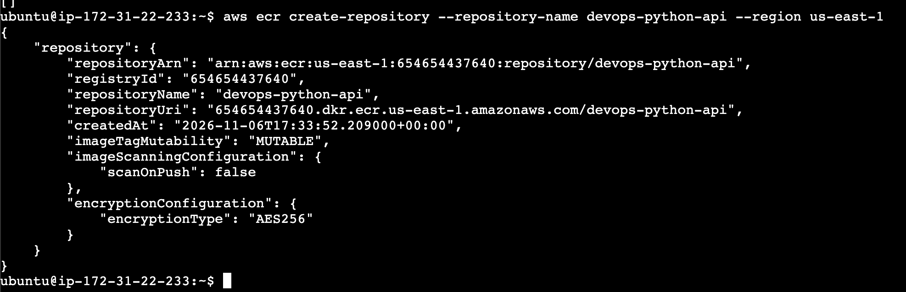
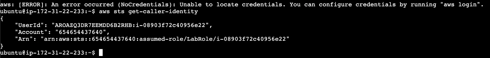
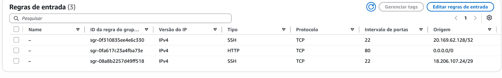
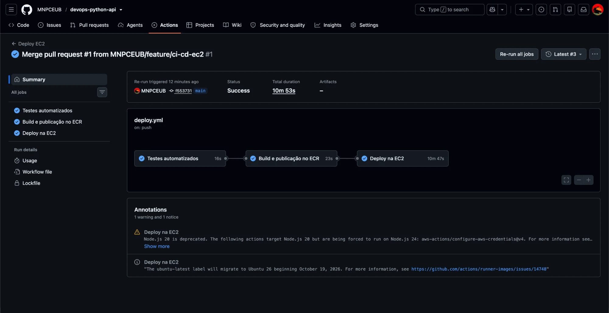
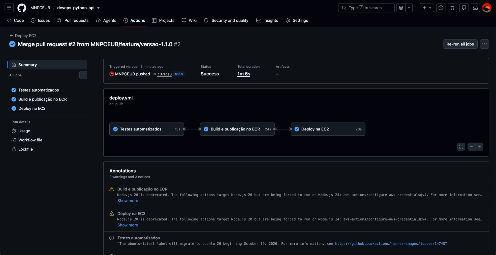
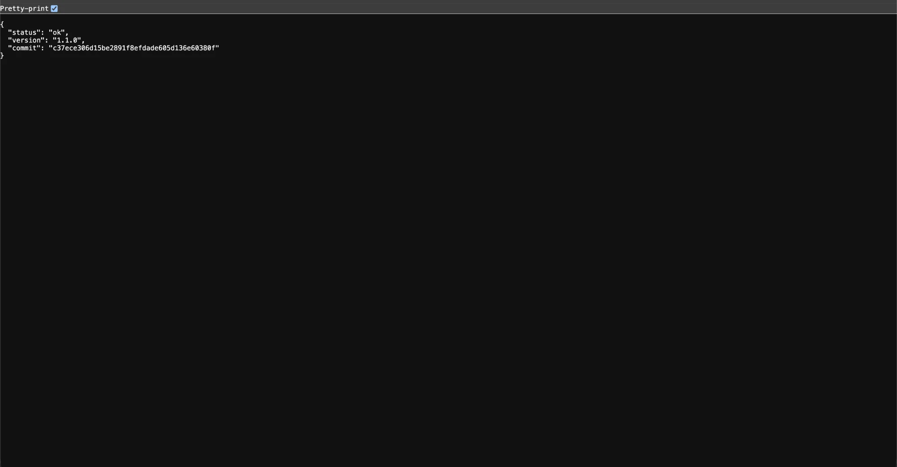

# API Python com CI/CD para Amazon EC2

API de tarefas escrita em Python (FastAPI) usada para demonstrar uma esteira completa de integração e entrega contínua: cada alteração passa por Pull Request e testes automatizados, e cada merge na `main` gera uma nova imagem Docker, publicada no Amazon ECR e implantada automaticamente em uma instância Amazon EC2.

**Fluxo:** alteração no código → branch → Pull Request → testes automatizados → merge na `main` → build Docker → publicação no ECR → deploy na EC2 → aplicação atualizada.

## Tecnologias utilizadas

| Ferramenta | Uso |
|---|---|
| Python 3.13 + FastAPI + Uvicorn | API HTTP |
| pytest, pytest-cov, Ruff | testes, cobertura e análise estática |
| Docker | empacotamento e execução da aplicação |
| GitHub Actions | pipelines de CI (`ci.yml`) e CD (`deploy.yml`) |
| Amazon ECR | registry privado das imagens |
| Amazon EC2 (Ubuntu) | servidor que executa o contêiner |
| AWS IAM (LabInstanceProfile) | permissão da EC2 para ler o ECR |

## Estrutura do repositório

```text
.
├── .github/workflows/
│   ├── ci.yml              # valida Pull Requests para a main
│   └── deploy.yml          # testa, publica no ECR e implanta na EC2 após merge
├── app/
│   ├── __init__.py
│   └── main.py             # API FastAPI
├── scripts/
│   └── deploy-ec2.sh       # comandos executados na EC2 durante o deploy
├── tests/test_api.py       # testes automatizados
├── docs/                   # material de apoio da disciplina
├── .dockerignore
├── .python-version
├── compose.yaml
├── Dockerfile
├── pyproject.toml          # configuração do pytest, cobertura e Ruff
├── requirements.txt        # dependências de execução
└── requirements-dev.txt    # dependências de desenvolvimento e CI
```

## Endpoints

| Método | Caminho | Objetivo | Resposta |
|---|---|---|---|
| GET | `/` | Apresentar a API | `200` |
| GET | `/health` | Saúde, versão e commit implantado | `200` |
| GET | `/tasks` | Listar tarefas | `200` |
| POST | `/tasks` | Criar uma tarefa | `201` |
| PATCH | `/tasks/{id}/done` | Concluir uma tarefa | `200` ou `404` |
| GET | `/docs` | Documentação Swagger | `200` |

## Execução local

Pré-requisitos: Git e Python 3.13.

```bash
python3 -m venv .venv
source .venv/bin/activate
python -m pip install --requirement requirements-dev.txt
uvicorn app.main:app --reload
```

Acesse <http://localhost:8000/health> e <http://localhost:8000/docs>.

Verificações (as mesmas executadas pelo GitHub Actions):

```bash
ruff check .
ruff format --check .
pytest --cov=app --cov-report=term-missing
```

## Docker

Construir a imagem, informando o commit que será exibido em `/health`:

```bash
docker build --build-arg GIT_SHA=$(git rev-parse HEAD) -t devops-python-api:local .
```

Executar o contêiner e testar:

```bash
docker run --rm -d -p 8000:8000 --name devops-python-api devops-python-api:local
curl http://localhost:8000/health
docker logs devops-python-api
docker rm -f devops-python-api
```

O `Dockerfile` instala as dependências de `requirements.txt` durante o build, roda a aplicação com um usuário sem privilégios, expõe a porta `8000` e define um `HEALTHCHECK` em `/health`.

## Pipeline de integração contínua (`ci.yml`)

Acionada na abertura ou atualização de um Pull Request para a `main` (e manualmente pela aba **Actions**).

1. **Qualidade e testes:** baixa o código, configura o Python, instala as dependências, executa `ruff check`, `ruff format --check` e `pytest` com cobertura mínima de 90%, e guarda os relatórios como artefato.
2. **Build e teste do container:** só roda se o job anterior passou (`needs`). Constrói a imagem, inicia o contêiner e consulta `/health`.

O resultado aparece no próprio Pull Request: verde quando tudo passa, vermelho indicando o step que falhou.

## Pipeline de entrega contínua (`deploy.yml`)

Acionada a cada push na `main`, ou seja, após o merge de um Pull Request. Os jobs são encadeados com `needs`, então **nada é publicado ou implantado se os testes falharem**.

1. **Testes automatizados:** executa novamente o `pytest`.
2. **Build e publicação no ECR:** autentica na AWS com credenciais guardadas em GitHub Secrets, faz login no ECR, constrói a imagem com a tag igual ao SHA do commit e a envia ao repositório `devops-python-api`.
3. **Deploy na EC2:**
   - libera a porta 22 no Security Group **somente para o IP do runner** daquela execução;
   - conecta por SSH na instância e executa [`scripts/deploy-ec2.sh`](scripts/deploy-ec2.sh), que autentica o Docker da EC2 no ECR usando a IAM Role da instância, baixa a imagem do commit, remove o contêiner anterior, inicia o novo e verifica `/health`;
   - consulta `http://<EC2>/health` de fora e confere se o commit publicado é o do merge;
   - remove a liberação da porta 22, mesmo se algum passo falhar.

Nenhum `docker pull` ou `docker run` é executado manualmente na instância.

## Arquitetura de implantação

```text
 Desenvolvedor ──push──▶ GitHub (branch) ──Pull Request──▶ ci.yml (testes)
                                                │
                                              merge
                                                ▼
                                   GitHub Actions: deploy.yml
                         testes ──▶ docker build ──▶ docker push ──▶ Amazon ECR
                                                                        │
                                  SSH (IP do runner liberado no SG)     │ docker pull
                                                ▼                       │ (IAM Role)
                                  Amazon EC2 (Ubuntu + Docker) ◀────────┘
                                  contêiner devops-python-api  porta 80 → 8000
                                                │
                                                ▼
                                   Usuário: http://<IP-PÚBLICO>/health
```

## Configuração da AWS e do GitHub

### AWS (AWS Academy Learner Lab, região `us-east-1`)

1. **ECR:** repositório privado `devops-python-api`.
2. **EC2:** Ubuntu Server, `t3.micro`, IAM instance profile `LabInstanceProfile` (permite ler o ECR sem guardar chaves na instância).
3. **Security Group da EC2:**
   - SSH (22) apenas para o IP do administrador; o pipeline libera temporariamente o IP do runner;
   - HTTP (80) liberado para acesso à API.
4. **Preparação da instância** (executada uma única vez):

   ```bash
   sudo apt update && sudo apt install -y docker.io curl
   sudo snap install aws-cli --classic
   sudo systemctl enable --now docker
   ```

### GitHub Secrets (Settings → Secrets and variables → Actions)

| Secret | Conteúdo |
|---|---|
| `AWS_ACCESS_KEY_ID` | credencial temporária do Learner Lab |
| `AWS_SECRET_ACCESS_KEY` | credencial temporária do Learner Lab |
| `AWS_SESSION_TOKEN` | token de sessão do Learner Lab |
| `EC2_HOST` | IP público da instância |
| `EC2_SSH_KEY` | conteúdo da chave privada `.pem` da instância |
| `EC2_SECURITY_GROUP_ID` | ID do Security Group da instância |

As credenciais do Learner Lab expiram ao final de cada sessão do laboratório; antes de cada deploy, atualize os três secrets da AWS com os valores de **AWS Details**. Nenhuma credencial é gravada no código ou no README.

## Acesso à API publicada

- Saúde e versão: <http://54.82.38.230/health>
- Swagger: <http://54.82.38.230/docs>
- Tarefas: <http://54.82.38.230/tasks>

> A instância roda no AWS Academy Learner Lab: ela fica disponível apenas durante a sessão do laboratório, e o IP público muda quando a instância é iniciada novamente. Nesse caso, basta atualizar o secret `EC2_HOST` e executar o workflow **Deploy EC2** pela aba **Actions**.

## Como verificar a versão implantada

```bash
curl http://54.82.38.230/health
```

Resposta esperada:

```json
{"status": "ok", "version": "1.1.0", "commit": "<SHA do último merge na main>"}
```

- `version` muda quando a aplicação é alterada (ex.: `1.0.0` → `1.1.0`).
- `commit` deve ser igual ao SHA do último commit da `main` e à tag da imagem no ECR.
- Na EC2: `sudo docker ps` mostra a imagem `...devops-python-api:<SHA>` em execução.

## Evidências

As capturas de tela ficam em [`docs/evidencias/`](docs/evidencias/). Os registros completos de cada execução estão na aba [Actions](https://github.com/MNPCEUB/devops-python-api/actions).

### Pull Requests

| PR | Objetivo | Resultado |
|---|---|---|
| [#1](https://github.com/MNPCEUB/devops-python-api/pull/1) | Implementação da esteira CI/CD (`feature/ci-cd-ec2`) | merge `f553731` → deploy da versão `1.0.0` |
| [#2](https://github.com/MNPCEUB/devops-python-api/pull/2) | Nova versão da API (`feature/versao-1.1.0`) | merge `c37ece3` → deploy da versão `1.1.0` |

### Integração contínua

Execuções do `ci.yml` disparadas pelos Pull Requests, com os jobs de qualidade, testes e container aprovados:





### Amazon ECR

Repositório privado `devops-python-api`. Cada deploy publica uma imagem com a tag igual ao SHA do commit, por exemplo `devops-python-api:c37ece306d15be2891f8efdade605d136e60380f`.



### Instância EC2

A instância usa a IAM Role `LabRole` (via `LabInstanceProfile`) para ler o ECR, sem chaves de acesso gravadas no servidor:



Regras de entrada: HTTP (80) aberto para a API; SSH (22) apenas para o EC2 Instance Connect e para o IP do runner durante o deploy:



### Deploy contínuo

Primeiro deploy, após o merge do PR #1:



Resposta da API registrada pelo próprio pipeline no step **Verificar a versão publicada**:

```json
{"status":"ok","version":"1.0.0","commit":"f5537317d094e63fd259b919c6375436e85eca86"}
```

### Atualização automática

Segundo deploy, disparado apenas pelo merge do PR #2, sem nenhum comando manual na instância:



API publicada na EC2 exibindo a nova versão e o commit do merge:



## Encerramento dos recursos

Após a avaliação: parar ou encerrar a instância EC2 e excluir as imagens e o repositório do ECR, evitando cobranças.
